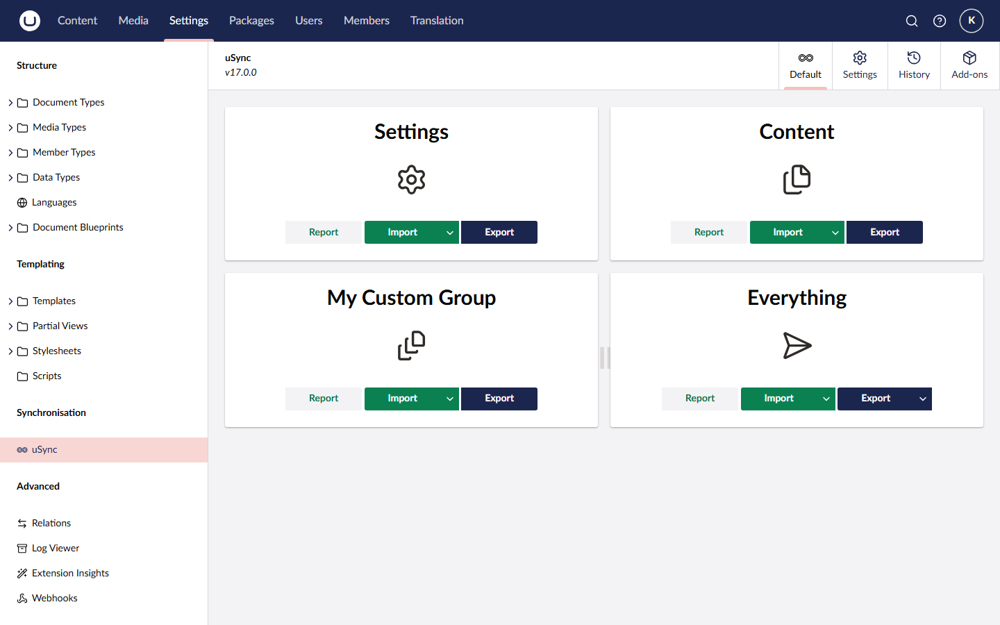
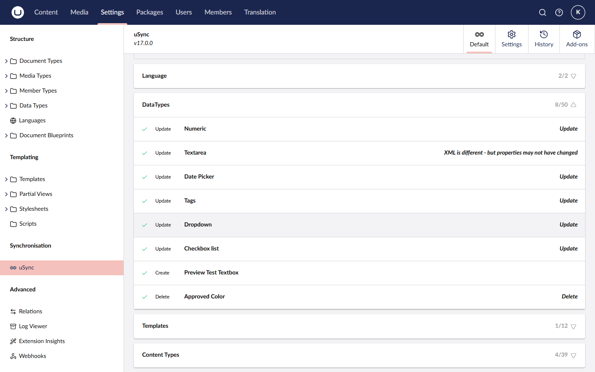
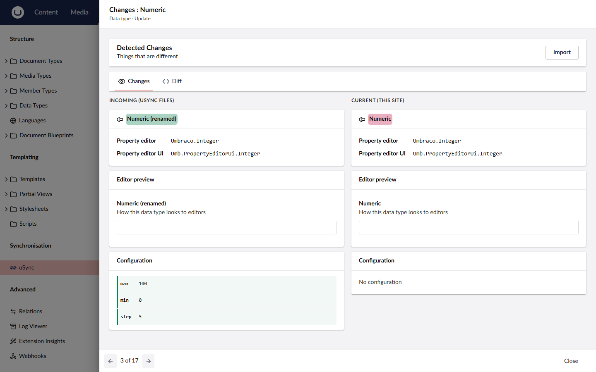

<p align="center">
  
</p>

# uSync

uSync writes the parts of your Umbraco site that live in the database out to disk as files, and reads them back in.

Once your document types, data types, templates and the rest are files, you can commit them to source control, review them in a pull request, and import them into another copy of the site. Make a change on your laptop, commit it, and the same change lands on the test and live servers when they import.



## What it syncs

Settings, which uSync syncs out of the box:

- Document types, media types and member types
- Data types
- Templates
- Languages
- Webhooks

Content, which you can turn on or off:

- Content and media
- Dictionary items
- Document blueprints
- Domains
- Relation types

uSync saves a file whenever you change something in the backoffice. Run a report and it compares those files with the site and lists what an import would change, before anything happens.



Click a change to see what is different between the file and the site, and import just that item if you want to.



## Install

uSync is on [NuGet](https://www.nuget.org/packages/uSync). Add it to your Umbraco site:

```bash
dotnet add package uSync
```

Run the site and open **Settings > uSync** in the backoffice. With no configuration uSync exports settings and content to `uSync/v17` in the site's root folder.

The uSync major version matches the Umbraco major version, so uSync 17 runs on Umbraco 17.

| Umbraco | uSync | Branch |
| --- | --- | --- |
| 17 (LTS) | 17.x | [`v17/main`](https://github.com/KevinJump/uSync/tree/v17/main) (default) |
| 18 | 18.x | [`v18/main`](https://github.com/KevinJump/uSync/tree/v18/main) |

See [Jumoo's support lifecycles](https://docs.jumoo.co.uk/SupportLifecycles) for how long each version gets fixes.

### Configuration

Most sites need no configuration. Settings go in `appsettings.json` under `uSync`. For example, to only write files for settings and leave content alone:

```json
"uSync": {
  "Settings": {
    "ExportOnSave": "Settings"
  }
}
```

The [uSync documentation](https://docs.jumoo.co.uk/usync/intro) covers every option, deployment patterns and the extension points.

### Nightly builds

Releases and release candidates go to nuget.org. Builds between releases go to the Jumoo nightly feed, if you want to try a fix before it ships:

```bash
dotnet nuget add source https://nightly.jumoo.uk/index.json -n "Jumoo Nightly"
```

## uSync.Complete

uSync is free and open source. [uSync.Complete](https://jumoo.co.uk/usync/complete/) is the paid add-on that pushes and pulls changes between servers from inside the backoffice, syncs single items and content trees, and takes snapshots.

## Packages in this repo

| Package | What it is |
| --- | --- |
| `uSync` | The one to install. Pulls in everything below that a site needs. |
| `uSync.Core` | Serializers that turn Umbraco items into XML and back. |
| `uSync.BackOffice` | Handlers, events, and the import and export logic. |
| `uSync.Backoffice.Management.Api` | The backoffice management API. |
| `uSync.Backoffice.Management.Client` | The backoffice UI (TypeScript and Lit). Also published to npm as [`@jumoo/usync`](https://www.npmjs.com/package/@jumoo/usync) for packages that extend it. |
| `uSync.BackOffice.Targets` | MSBuild targets that include the uSync folder when you publish the site, plus the `appsettings.json` schema. |
| `uSync.History` | Keeps a history of imports and exports. |
| `uSync.Community.Contrib` | Value mappers for third-party property editors. |
| `uSync.Community.DataTypeSerializers` | Serializers for data type configuration. |
| `uSync.AutoTemplates` | Watches the views folder and creates templates for new files. |
| `uSync.Extend` | Helpers for writing your own handlers and serializers. |

## Contributing

Bug reports, ideas and pull requests are all welcome.

- Report bugs and ask questions in [GitHub issues](https://github.com/KevinJump/uSync/issues). Say which Umbraco and uSync versions you run.
- Larger changes are worth an issue first, so we can agree on the approach before you write the code.
- Branch from `v17/main` and open your pull request against it. It is the default branch and the long-term support line. We merge changes forward into `v18/main` ourselves.

### Building

You need the [.NET 10 SDK](https://dotnet.microsoft.com/download) and a current LTS version of [Node.js](https://nodejs.org/).

```bash
npm run install-client
```

```bash
npm run build-client
```

```bash
dotnet build uSync.slnx
```

```bash
dotnet test uSync.Tests
```

`npm run watch-client` rebuilds the backoffice UI as you edit it.

To try your changes, reference the `uSync` project from an Umbraco site of your own. The end-to-end tests in [`uSync.Tests.E2E`](./uSync.Tests.E2E/README.md) run with Playwright against a local site.

Every pull request is built and tested on GitHub Actions.

Please follow the [code of conduct](./CODE_OF_CONDUCT.md).

## License

uSync is licensed under the [Mozilla Public License 2.0](./LICENSE).

Made by [Jumoo](https://jumoo.co.uk). You can reach us at info@jumoo.co.uk.
